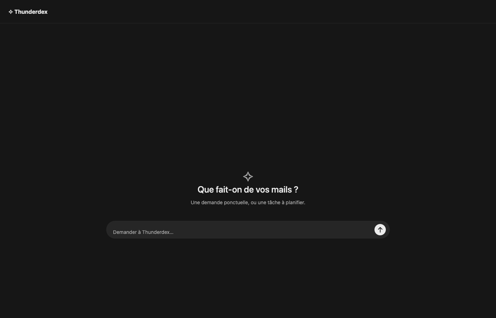
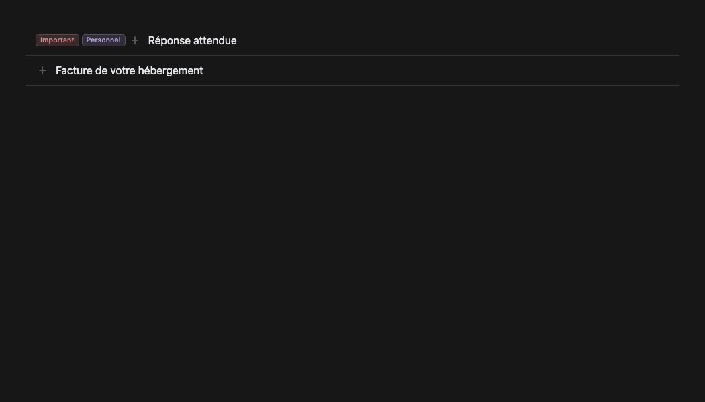

<p align="center"></p>

<h1 align="center">Thunderdex</h1>

<p align="center"><b>An AI mail assistant that lives inside Thunderbird: chat with your inbox, schedule mail tasks, stay in control.</b></p>

<p align="center">


</p>

> **Unofficial project.** Thunderdex is an independent add-on for Thunderbird. It is not affiliated with, endorsed or sponsored by MZLA Technologies or the Mozilla Foundation. "Thunderbird" is a trademark of the Mozilla Foundation, used here only to describe compatibility.

🇬🇧 English · 🇫🇷 [Français](#-français)

---

## What it does

Thunderdex adds two entries under your folder pane:

- **✧ Ask**: a streaming chat with an AI agent that can search, read, sort, draft and (if you allow it) send mail across **all your Thunderbird accounts**, through the [Model Context Protocol](https://modelcontextprotocol.io).
- **◷ Planned**: scheduled mail tasks ("every weekday at 8:00, summarise unread invoices", "every 15 min, draft replies to client X"), with day/hour windows, end dates, pause/resume, run history and approvals.

Your credentials never leave Thunderbird. The agent drives Thunderbird through a local MCP server; the UI talks to a local service over a **private Unix socket** (mode 0600, no TCP port).

<p align="center"></p>
<p align="center"></p>

## Architecture

```
Thunderbird ──(experiment API, Unix socket)──▶ service/server.py ──(stdio JSON-RPC)──▶ codex app-server
     ▲                                              │  scheduler · approvals · streaming
     └──────── thunderbird-mcp add-on ◀──(MCP)──────┘
```

| Part | Role |
|---|---|
| `addon/` | Thunderbird add-on (MV2 + experiment API): sidebar entries, chat UI, task UI, native tag chips, folder label harmonisation. Talks **directly** to the socket from Gecko, with no helper process per request. |
| `service/server.py` | Single long-running Python process: Codex session manager, token streaming, task scheduler, approval broker, alert runner. |
| `row-actions/` | Optional companion add-on: one-click **archive** button next to each row's trash, and **rapid trash clicks** (Thunderbird drops clicks with `detail > 1`; each fast repeat now deletes the row under the pointer). |
| `cli/tbmail` | Terminal client for the same MCP tools (`tbmail inbox`, `tbmail search`, `tbmail alerts …`). |

## Safety model

- **Enforced tool allowlists.** Each scheduled task has a mode: `read`, `draft` or `write` (with separate *organise*, *trash* and *send* switches). The mode is enforced by Codex itself through `mcp_servers.thunderbird.enabled_tools`: a read-only task **cannot see** `mail_send` or `mail_delete`, even if a malicious email tells it to.
- **No silent approvals.** Every agent permission request is shown in the chat and waits for you.
- **Mail is data, not instructions.** Agent instructions state it explicitly; tool restrictions make it hold.
- **Crash and reboot safe.** Runs are claimed before dispatch. After a crash, sleep or reboot, only side-effect-free runs (read/draft) are replayed, once. Write runs are marked *interrupted* for you to check.
- Missed repeats are not fired in bursts; daily and weekly tasks keep their wall-clock time across DST.

## Performance

- One background process, started by `launchd`, with Codex prewarmed at login so the first message answers immediately.
- UI ↔ service IPC goes over a raw Unix socket from Gecko, without spawning a process per request.
- Live token streaming; state polling slows to once a minute while a stream is open.
- Alerts cost **zero processes** while you have no alert rule.
- State is flushed to disk by a background writer, so streaming never stalls on I/O.
- Ask chats only expose mail tools, keeping prompts small and first tokens fast.
- Message-list and folder-pane hooks ignore unread-count churn: zero extra work when mail arrives.
- macOS notifications when a task finishes or needs your approval.

## Requirements

- macOS, Thunderbird **159+**
- [Codex CLI](https://github.com/openai/codex) (`npm i -g @openai/codex`), signed in with `codex login`
- [Thunderbird-MCP](https://github.com/U-C4N/Thunderbird-MCP) installed, its add-on enabled, and registered in `~/.codex/config.toml` as `[mcp_servers.thunderbird]`

## Install

```sh
git clone https://github.com/justarkov7-coder/thunderdex && cd thunderdex
./install.sh                       # starts the service, builds dist/thunderdex.xpi
$EDITOR ~/.config/thunderdex/config.json   # list the mailboxes tasks may use
```

Then in Thunderbird: **Add-ons Manager → ⚙ → Install Add-on From File… → `dist/thunderdex.xpi`**.
Optional: `python3 row-actions/build.py` and install `dist/thunderdex-row-actions.xpi` the same way.

> Experiment APIs run with full privileges. Experiment add-ons are accepted on addons.thunderbird.net only after manual review, so for now install from source and read the code first (it is short).

## Tests

```sh
python -m pytest service cli           # scheduler, approvals, streaming, tool allowlists
NODE_PATH=$(npm root -g) node addon/test_ui.cjs     # UI (Playwright + Chrome)
NODE_PATH=$(npm root -g) node addon/test_tags.cjs
```

## Roadmap

- "Ask about this message" button in the message pane
- Markdown rendering and search in chat history
- Per-task model/effort selection
- Linux support (systemd user unit)

## License

Dual-licensed under **[MIT](LICENSE-MIT)** or **[Apache-2.0](LICENSE-APACHE)**, at your option.
Unless you explicitly state otherwise, any contribution you submit is dual-licensed as above, without additional terms.

---

## 🇫🇷 Français

<p align="center"><b>Un assistant mail IA intégré à Thunderbird : discute avec ta boîte mail, planifie des tâches, garde le contrôle.</b></p>

> **Projet non officiel.** Thunderdex est un module complémentaire indépendant pour Thunderbird. Il n'est ni affilié, ni approuvé, ni sponsorisé par MZLA Technologies ou la Mozilla Foundation. « Thunderbird » est une marque de la Mozilla Foundation, citée ici uniquement pour indiquer la compatibilité.

### Ce que ça fait

Thunderdex ajoute deux entrées sous la liste des dossiers :

- **✧ Ask** : un chat en streaming avec un agent IA qui peut chercher, lire, classer, rédiger et, si tu l'autorises, envoyer des mails sur **tous tes comptes Thunderbird**, via le [Model Context Protocol](https://modelcontextprotocol.io).
- **◷ Planifié** : des tâches mail planifiées (« chaque jour ouvré à 8 h, résume les factures non lues », « toutes les 15 min, prépare des brouillons de réponse au client X »), avec jours et plages horaires, date de fin, pause et reprise, historique des exécutions et validations.

Tes identifiants ne quittent jamais Thunderbird. L'agent pilote Thunderbird via un serveur MCP local, et l'interface parle à un service local par un **socket Unix privé** (droits 0600, aucun port TCP).

### Architecture

```
Thunderbird ──(API expérimentale, socket Unix)──▶ service/server.py ──(JSON-RPC stdio)──▶ codex app-server
     ▲                                                │  planificateur · validations · streaming
     └──────── add-on thunderbird-mcp ◀──(MCP)────────┘
```

| Partie | Rôle |
|---|---|
| `addon/` | Module Thunderbird (MV2 + API expérimentale) : entrées dans la barre latérale, interface du chat et des tâches, pastilles d'étiquettes natives, harmonisation des noms de dossiers. Parle **directement** au socket depuis Gecko, sans lancer de processus par requête. |
| `service/server.py` | Un seul processus Python permanent : gestion des sessions Codex, streaming des réponses, planificateur, validations, alertes. |
| `row-actions/` | Module compagnon optionnel : bouton **archiver** en un clic à côté de la corbeille de chaque ligne, et **suppression en clics rapides** (Thunderbird ignore les clics avec `detail > 1` ; chaque clic rapide supprime désormais la ligne sous le curseur). |
| `cli/tbmail` | Client en ligne de commande pour les mêmes outils MCP (`tbmail inbox`, `tbmail search`, `tbmail alerts …`). |

### Sécurité

- **Listes blanches d'outils appliquées.** Chaque tâche planifiée a un mode : `lecture`, `brouillons` ou `écriture` (avec des interrupteurs séparés pour *classer*, *corbeille* et *envoi*). Codex applique lui-même ce mode via `mcp_servers.thunderbird.enabled_tools` : une tâche en lecture seule **ne voit pas** `mail_send` ni `mail_delete`, même si un mail malveillant le lui demande.
- **Aucune validation silencieuse.** Chaque demande d'autorisation de l'agent s'affiche dans le chat et t'attend.
- **Un mail est une donnée, pas une consigne.** Les instructions de l'agent le disent explicitement, et les restrictions d'outils le garantissent.
- **Résistant aux plantages et redémarrages.** Une exécution est réservée avant d'être lancée. Après un plantage, une mise en veille ou un redémarrage, seules les exécutions sans effet de bord (lecture, brouillons) sont relancées, une seule fois. Les exécutions en écriture sont marquées *interrompues* pour que tu vérifies.
- Les répétitions manquées ne sont pas exécutées en rafale. Les tâches quotidiennes et hebdomadaires gardent leur heure lors des changements d'heure.

### Performances

- Un seul processus en arrière-plan, lancé par `launchd`. Codex est préchauffé à l'ouverture de session, donc le premier message répond tout de suite.
- L'interface communique avec le service par un socket Unix brut depuis Gecko, sans lancer de processus par requête.
- Streaming des réponses en direct. Pendant un stream, l'état n'est relu qu'une fois par minute.
- L'état est écrit sur le disque par un thread dédié, donc le streaming ne se bloque jamais sur une écriture.
- Le chat Ask ne voit que les outils mail : prompts plus courts, premiers mots plus rapides.
- Les hooks de la liste des messages et des dossiers ignorent les changements de compteurs de non-lus : aucun travail en plus à l'arrivée d'un mail.
- Les alertes ne lancent **aucun processus** tant que tu n'as pas de règle.
- Notifications macOS quand une tâche se termine ou attend ta validation.

### Prérequis

- macOS, Thunderbird **159 ou plus**
- [Codex CLI](https://github.com/openai/codex) (`npm i -g @openai/codex`), connecté avec `codex login`
- [Thunderbird-MCP](https://github.com/U-C4N/Thunderbird-MCP) installé, son add-on activé, et déclaré dans `~/.codex/config.toml` sous `[mcp_servers.thunderbird]`

### Installation

```sh
git clone https://github.com/justarkov7-coder/thunderdex && cd thunderdex
./install.sh                               # démarre le service, construit dist/thunderdex.xpi
$EDITOR ~/.config/thunderdex/config.json   # liste les boîtes mail utilisables par les tâches
```

Ensuite dans Thunderbird : **Modules complémentaires → ⚙ → Installer un module depuis un fichier… → `dist/thunderdex.xpi`**.
Optionnel : `python3 row-actions/build.py`, puis installe `dist/thunderdex-row-actions.xpi` de la même façon.

> Les API expérimentales s'exécutent avec tous les privilèges. Sur addons.thunderbird.net, les modules qui en utilisent ne sont acceptés qu'après une revue manuelle. Pour l'instant, installe-le depuis les sources et lis le code avant (il est court).

### Tests

```sh
python -m pytest service cli           # planificateur, validations, streaming, listes blanches d'outils
NODE_PATH=$(npm root -g) node addon/test_ui.cjs     # interface (Playwright + Chrome)
NODE_PATH=$(npm root -g) node addon/test_tags.cjs
```

### Feuille de route

- Bouton « Demander à propos de ce mail » dans le volet de lecture
- Rendu Markdown et recherche dans l'historique des conversations
- Choix du modèle et de l'effort par tâche
- Support Linux (unité systemd utilisateur)

### Licence

Double licence **[MIT](LICENSE-MIT)** ou **[Apache-2.0](LICENSE-APACHE)**, au choix.
Sauf mention contraire explicite de ta part, toute contribution que tu soumets est placée sous cette même double licence, sans conditions supplémentaires.
